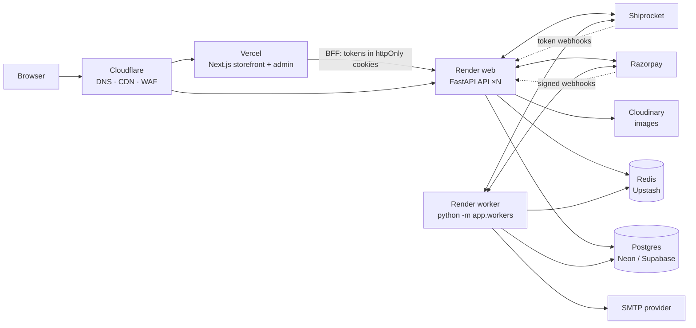
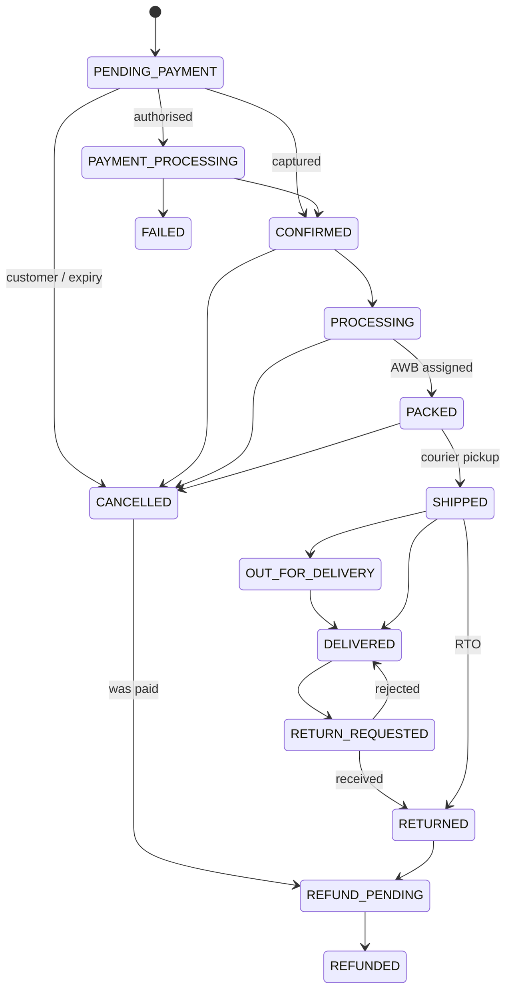

# Architecture

TheHotSmoothieCo is a **modular monolith**: one FastAPI application, split into business modules
with explicit boundaries, plus a background worker built from the same code. One deployable keeps
operations cheap and simple today; the module boundaries keep extraction into services possible later.

## System overview



**Postgres is the only source of truth.** Redis holds nothing that can't be lost: rate-limit
counters, short-lived caches, the Shiprocket auth token, and the worker heartbeat. Every Redis call
fails open.

## Modules

```
app/
  core/          config, DB/Redis clients, errors, logging + request IDs, rate limits, body limits,
                 client IP, cache, pagination, security primitives
  auth/          sessions, JWT, refresh rotation, email verification, password reset, RBAC deps
  users/         profiles, addresses, roles
  catalog/       categories, collections, tags, attributes, products, variants, media, CSV io
  inventory/     stock ledger + reservations
  cart/ wishlist/ coupons/
  checkout/      pricing (pure functions) + cart -> order transaction
  orders/        snapshots, state machine, history, lifecycle (cancel/refund/returns), admin desk
  payments/      PaymentProvider (Razorpay), capture/refund handling, webhook event store
  shipping/      ShippingProvider (Shiprocket), shipments, tracking
  notifications/ outbox, templates, SMTP sender
  reviews/ search/ media/
  admin/ audit/  dashboard, analytics, customers, roles, banners; audit middleware
  webhooks/      signed inbound webhooks -> dedupe -> module handlers
  workers/       scheduler (Postgres advisory locks) + jobs
```

Inside a module: **router** (HTTP only: parse, auth, call service) → **service** (business rules,
transactions) → **repository / models** (queries, schema). Route handlers never contain business
logic. Modules call each other's *services*, never each other's routers.

Transaction ownership: top-level service functions commit; building blocks that must compose
(`inventory.reserve`, `coupons.claim`, `catalog.service.stage_*`, `payments.create_refund`, the
notification `enqueue`) only flush, so a caller can combine them atomically.

## Critical flows

### Checkout → payment

```mermaid
sequenceDiagram
    participant C as Customer (Next.js)
    participant A as API
    participant DB as Postgres
    participant RZ as Razorpay
    C->>A: POST /checkout (Idempotency-Key, expected_total)
    A->>DB: BEGIN; live prices, coupon, totals, order + snapshots,<br/>reserve stock (conditional UPDATE), claim coupon; COMMIT
    A-->>C: order PENDING_PAYMENT (stock held 15 min)
    C->>A: POST /payments/orders/{id}/initiate
    A->>RZ: create gateway order (once per order)
    C->>RZ: pays in Razorpay Checkout
    C->>A: POST /payments/orders/{id}/verify (signature)
    A->>RZ: re-fetch payment (never trust the browser)
    RZ-->>A: webhook payment.captured (signed)
    Note over A: both paths -> one idempotent handler:<br/>commit reservation, CONFIRMED, clear cart, enqueue email
```

Guarantees, each covered by tests: no overselling under concurrency; the same Idempotency-Key never
creates a second order; duplicate/late/out-of-order webhooks are no-ops; payment after expiry or
cancellation is auto-refunded; a second capture is auto-refunded; refunds can't exceed the capture
and are idempotent per key.

### Order state machine



`orders.service.record_transition` is the only writer of `orders.status`; it rejects illegal moves,
writes `order_status_history`, and queues customer emails. `advance()` walks the forward path for
courier updates and never moves backwards.

### Inventory

`available = on_hand − reserved`. Checkout reserves (conditional `UPDATE … WHERE on_hand − reserved >= qty`,
rows touched in sorted order to avoid deadlocks), payment commits (`on_hand −= q, reserved −= q,
sold += q`), cancel/expiry releases. CHECK constraints (`reserved <= on_hand`, non-negatives) make
overselling impossible even for a buggy code path. Every change writes `inventory_transactions`.

### Notifications (transactional outbox)

Business code inserts a `notifications` row in the same transaction as the change. The worker
claims due rows (`FOR UPDATE SKIP LOCKED` + 5-minute lease), sends oldest-first, retries with
exponential backoff and jitter, and dead-letters after 6 attempts. Delivery is at-least-once.

## Cross-cutting

| Concern | Where |
|---|---|
| Errors | `AppError` subclasses with stable codes → `{"success": false, "error": {code, message, details}}`; DB constraint names mapped to codes; unknown errors → `INTERNAL_ERROR` (logged, never leaked) |
| Logging | structlog JSON to stdout; every request logs method, path, status, latency, client IP, request ID (`X-Request-ID` echoed) |
| Audit | middleware records every admin mutation, including denied attempts (`audit_logs`) |
| Idempotency | checkout (Idempotency-Key ↔ unique `(user_id, idempotency_key)`), payments (one gateway order per order; capture handler keyed on gateway ids), webhooks (`webhook_events` unique `(provider, event_id)`), refunds (unique `idempotency_key`), inventory (only `ACTIVE` reservations are settled), notifications (unique `dedupe_key`) |
| Caching | Redis read-through for category tree, collections, banners, dashboard, PIN serviceability; explicit invalidation on writes; TTL bounds staleness |
| Limits | per-route Redis rate limits; per-account login lockout; 1 MB JSON / 16 MB upload body limits |
| Observability | Sentry (API + worker), `/health/live`, `/health/ready` (DB + Redis), `/health/worker` (heartbeat) |

## Scaling

- The API is stateless: run as many instances as needed. The worker can also be scaled; each job
  holds a Postgres advisory lock, so a job never runs twice at once.
- Measured on a laptop against 20k products / 60k variants / 200k orders: listing 9 ms, product
  detail 12 ms, search 33 ms per request; roughly 90 req/s per worker core under load. All hot
  queries are index scans (verified with `EXPLAIN ANALYZE`).
- Storefront catalog pages are served via Next.js ISR + CDN, so most catalog traffic never
  reaches the API.
- At ~10× today's needs: more API instances; a Postgres read replica for analytics; a dedicated
  search engine behind `SearchBackend` once the catalog passes ~100k products.

## Decisions

| Decision | Why |
|---|---|
| Modular monolith | One deploy, one DB transaction across modules (checkout needs it); boundaries preserved for later extraction |
| Integer paise everywhere | No float errors; maps 1:1 to Razorpay amounts |
| Global variant attributes | Cross-catalog filtering ("all A3 posters") |
| Postgres outbox instead of a message broker | Exactly the durability we need with zero extra infrastructure |
| Custom scheduler instead of Celery/ARQ | All work is periodic or outbox-driven; ARQ's only installable version pins an old redis-py; advisory locks give cross-instance exclusivity for free |
| Postgres full-text + trigram search | Cheap, good enough to ~100k products; swappable via `SearchBackend` |
| Ambiguous gateway refunds stay PENDING | Never risk a double refund; the webhook settles them |
| Whole-order returns | Simplest correct model for posters; per-item returns when needed |
| GST-inclusive pricing defaults | Indian retail norm; configurable (confirm rates with an accountant) |

## Portability (initial → AWS)

| Today | Later | Code change |
|---|---|---|
| Vercel | CloudFront + ECS/Amplify | none (frontend deploy target) |
| Render web + worker | ECS/Fargate services (same image, same two commands) | none |
| Neon / Supabase | RDS / Aurora PostgreSQL | `DATABASE_URL` (+ `DB_PGBOUNCER` if using RDS Proxy) |
| Upstash | ElastiCache Redis | `REDIS_URL` |
| Cloudinary | S3 + CloudFront | one new `MediaStorage` class + config |
| SMTP provider | SES | `SMTP_*` |
