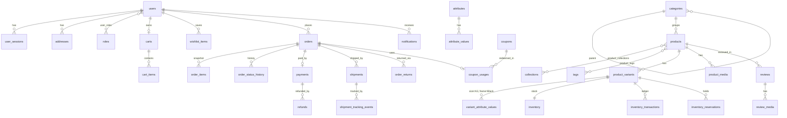

# Database

PostgreSQL (15+; `NULLS NOT DISTINCT` and `pg_trgm` are used) is the single source of truth.
Every schema change is an Alembic migration in `backend/migrations/versions/`.

## Conventions

- **UUID primary keys** (generated in Python) double as public IDs: nothing sequential is exposed.
- **Money is integer paise** (`*_paise` columns). No floats, no `NUMERIC` rounding questions.
- `created_at` / `updated_at` (`timestamptz`) on mutable tables; server-generated values are
  fetched via `RETURNING` (`eager_defaults`) so async code never lazy-loads them.
- **Constraints are the last line of defence**: CHECKs on stock (`reserved <= on_hand`), prices,
  ratings, statuses; partial unique indexes for business uniqueness (one live review per
  user+product, one default address, one open return, one cart per user…).
- **Soft delete** only where history must survive: `users.deleted_at`, `reviews.deleted_at`.
  Products/variants/coupons are archived or deactivated, never deleted once referenced.
- **Snapshots**: orders copy names, prices, attributes and addresses; later edits never change them.
- Constraint names follow a fixed naming convention so `alembic check` stays deterministic, and
  user-facing ones are mapped to error codes in `app/core/exceptions.py`.

## Entities



Also: `user_tokens` (single-use email tokens, hashed), `webhook_events` (inbound webhook dedupe +
dead letters), `notification_templates` (staff overrides), `banners`, `audit_logs`.

## Indexes worth knowing

| Index | Serves |
|---|---|
| `ix_products_active_created`, `ix_products_active_price` (partial, ACTIVE) | storefront listing + keyset pagination |
| `ix_products_search_vector` (GIN), `ix_products_title_trgm` (GIN trgm) | full-text search, typo fallback |
| `uq_product_variants_sku` | SKU search, CSV import |
| `ix_orders_user_created`, `ix_orders_status_created` | order history, admin queues |
| `ix_orders_paid_at` (partial), `ix_orders_customer_email` | revenue analytics, support lookup |
| `ix_users_{email,full_name,phone}_trgm` | admin customer search (ILIKE) |
| `ix_inventory_reservations_active_expiry` (partial) | expiry sweep |
| `ix_notifications_due` (partial) | outbox claim |
| `ix_reviews_product_public` (partial) | product reviews page |

Verified with `EXPLAIN ANALYZE` against 20k products / 60k variants / 200k orders: every
customer-facing query is an index scan and runs in ≈1 ms. Remaining sequential scans are
deliberate full aggregates on cached admin dashboards.

## Migrations

```bash
# 1. change models, then
alembic revision --autogenerate -m "short description"
# 2. READ the generated file — autogenerate misses: extensions, data backfills, CONCURRENTLY
# 3. test both directions
alembic upgrade head && alembic downgrade -1 && alembic upgrade head && alembic check
```

Rules for live databases:

- **Never** change production schema by hand. CI runs `alembic upgrade head && alembic check`, and
  Render runs `alembic upgrade head` as the pre-deploy command: a failing migration aborts the
  deploy before new code serves traffic.
- **Indexes on big tables**: `CREATE INDEX CONCURRENTLY` inside
  `with op.get_context().autocommit_block():` (see `…_performance_indexes.py`).
- **Expand → migrate → contract** for anything that would break the running version: add the
  new column (nullable), deploy code writing both, backfill in batches, switch reads, then drop the
  old column in a later release. Old and new app versions overlap during every deploy.
- No long `ALTER … SET NOT NULL` / type rewrites on hot tables without a plan
  (`NOT VALID` constraints + `VALIDATE CONSTRAINT`).

## Backups and restore

The app never does its own data recovery; it relies on the provider's backups plus our own
logical dumps.

| Layer | Neon | Supabase | RDS (later) |
|---|---|---|---|
| Point-in-time restore | Branch from any point within the plan's history window | PITR add-on (paid); daily backups on Pro | Automated backups + PITR (≤35 days) |
| Our safety net | Nightly `pg_dump` to object storage (below) | same | same + snapshots |

Nightly logical dump (GitHub Actions cron or any scheduler with network access):

```bash
pg_dump "$DIRECT_DATABASE_URL" --format=custom --no-owner --no-privileges \
  --file="hsc-$(date -u +%Y%m%dT%H%MZ).dump"
# upload to an R2/S3 bucket with versioning + 30-day lifecycle; never store dumps in the repo
```

Use the **direct** (non-pooler) connection string for `pg_dump`/`pg_restore`.

### Restore procedure

1. **Decide the target time** (just before the incident) and **pause writes**: scale the web service
   to 0 or enable maintenance at Cloudflare; stop the worker.
2. **Restore into a new database**, never over the live one:
   - Neon: create a branch at the timestamp → get its connection string.
   - Supabase: PITR restore to the timestamp (or restore a daily backup).
   - From a dump: `createdb hsc_restore && pg_restore --no-owner -d "$URL" hsc-…dump`.
3. **Verify**: `alembic current` matches the deployed code's head; spot-check recent orders,
   payments and stock against Razorpay/Shiprocket dashboards.
4. **Reconcile external systems** for the gap between the restore point and the incident: payments
   captured in Razorpay but missing locally are re-applied by replaying webhooks from the Razorpay
   dashboard (handlers are idempotent); shipments via the `sync_shipments` job.
5. **Switch** `DATABASE_URL` to the restored database, deploy, resume the worker, lift maintenance.
6. Write a short incident note: what happened, data window affected, follow-ups.

Test this procedure on staging at least once per quarter.

## Data retention

The `cleanup` job deletes stale guest carts (30 days idle), expired auth tokens (7 days),
expired/revoked sessions (30 days) and processed webhook events (90 days). Orders, payments,
refunds, inventory ledger and audit logs are kept indefinitely (accounting and tax records).
